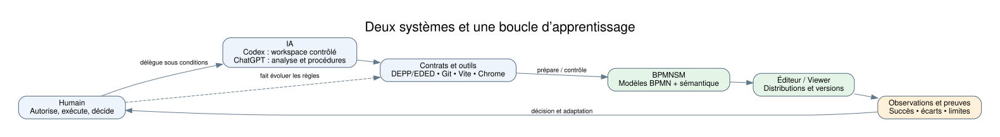
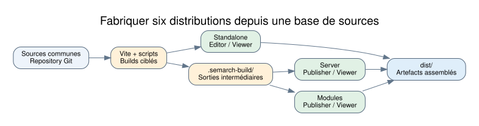
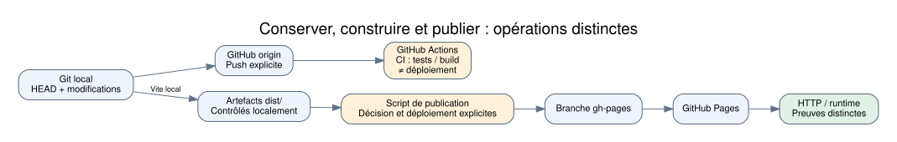
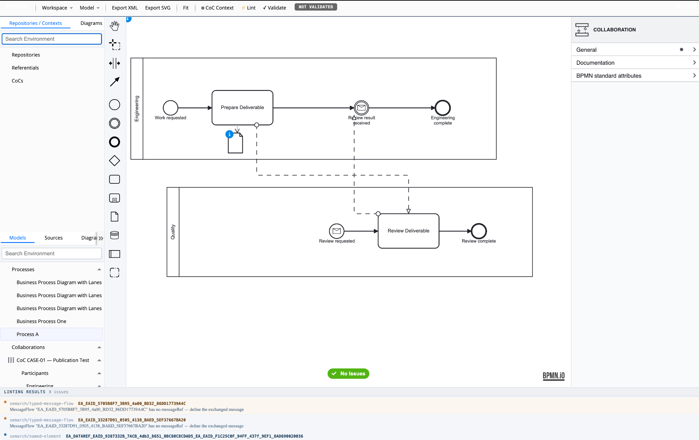
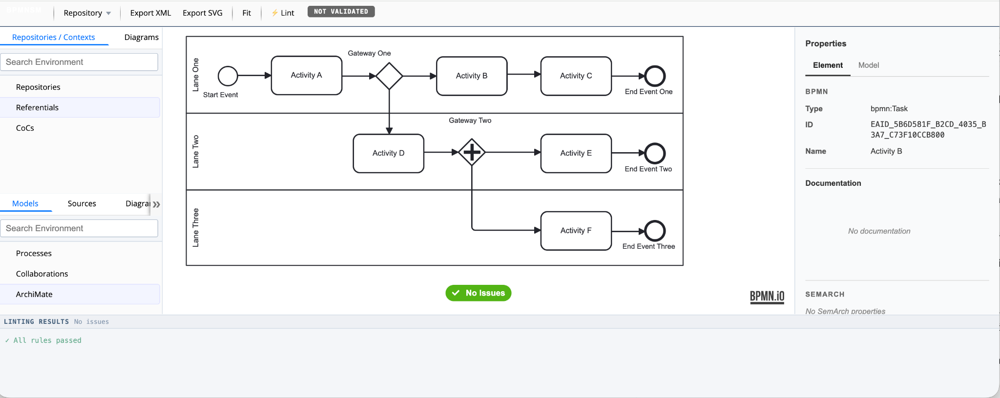

# Et si l’IA transformait notre manière de conduire l’ingénierie des systèmes logiciels ?

**COM-01 — article approfondi V3 · accepté éditorialement sous réserve de corrections mineures le 16 octobre 2026 · non publié**

Depuis début septembre 2026, je mène une expérimentation dans laquelle l’intelligence artificielle participe non seulement à l’écriture de code, mais à plusieurs activités nécessaires pour faire évoluer un système logiciel : comprendre l’existant, préparer des changements, intégrer des fonctions, définir et exécuter des vérifications, examiner les résultats et préparer les distributions.

La question n’est pas « un LLM sait-il programmer ? ». Je cherche à comprendre **quelles tâches peuvent être déléguées, dans quelles conditions, avec quelles preuves et quelle responsabilité**. Pour y répondre, il faut expérimenter sur un vrai logiciel, avec ses contraintes, ses incidents et ses décisions de publication.

## Un terrain réel et deux systèmes à observer

Mon cas d’usage est **BPMNSM**, une application web permettant de travailler sur des modèles de processus métier BPMN et leurs informations sémantiques. Dans les captures collectées, l’**éditeur** présente des commandes et outils de modélisation, tandis que le **viewer** présente une interface de consultation et d’inspection. Ces images n’établissent pas à elles seules l’inventaire exhaustif de leurs capacités respectives. Le logiciel est distribué sous plusieurs configurations, ce qui ajoute des problèmes réels de construction, d’intégration et de publication.

Deux systèmes évoluent simultanément : **le système d’intérêt** (BPMNSM et ses fonctions) et **le système d’ingénierie** (ingénieur, IA, outils, contrats, preuves et décisions). C’est l’organisation et l’évolution du second qui constituent le véritable sujet de mon expérimentation.

## Quelle place concrète pour l’IA ?

J’ai utilisé des configurations différentes, qu’il serait trompeur de confondre. Avec **Codex**, certaines opérations pouvaient être conduites dans un workspace contrôlé, soumis à des permissions. Avec **ChatGPT en mode Chat**, l’IA propose des analyses, des procédures Terminal et des contrôles ; je décide d’autoriser l’étape, exécute les commandes sur mon Mac, lui transmets les journaux et examine les conclusions. Cette configuration ne donne pas à l’IA un accès direct au Repository local.

La collaboration s’appuie sur des contrats expérimentaux **DEPP/EDED** : pour chaque affirmation (claim), nous cherchons une observation dans un contexte défini, identifions ses limites et déterminons la décision réellement justifiée. Une réussite de build ne démontre ni le bon fonctionnement dans Chrome ni un déploiement GitHub Pages.

## Pourquoi l’architecture du logiciel compte

BPMNSM dispose de six distributions : deux autonomes (éditeur et viewer), deux « server » (publisher et viewer) et deux « modules » (publisher et viewer). Vite et les scripts construisent les variantes, avec des sorties intermédiaires pour certaines cibles, avant assemblage des artefacts. Les figures suivantes distinguent **fabrication** et **publication**, plutôt que d’imaginer un pipeline unique où chaque réussite implique automatiquement la suivante.

## Ce qui s’est passé dans les expérimentations

Une campagne a produit **six builds réussis**, mais le premier contrôle ne détectait que **deux artefacts sur six** : il recherchait des fichiers dans `dist/`, alors que quatre sorties intermédiaires se trouvaient dans `.semarch-build/`. L’investigation des configurations de build et des destinations réelles a permis de retrouver et vérifier les six productions. Le problème observé n’était pas une défaillance des six builds, mais une hypothèse insuffisante du vérificateur. **Qui a rédigé le contrôleur initial n’est pas établi par les preuves actuellement consolidées.**

Dans une autre campagne, une intégration autorisée humainement n’a pas été exécutée par Codex : le Repository cible était hors de son périmètre d’écriture annoncé. Le rapport documente un **arrêt préventif** et non un refus système après tentative.

Enfin, un scénario Chrome comportait **six confirmations humaines** ; la preuve conservée indiquait pourtant `REVIEW_REQUIRED`. Ces confirmations ne suffisaient pas à démontrer toutes les propriétés de sauvegarde et réouverture physique.

Ces épisodes ont conduit à mieux séparer autorisation, permissions effectives, exécution, vérification et validation, puis à regrouper et automatiser certaines campagnes de preuve pour limiter les reprises.

## Ce que j’apprends — et ce que je ne peux pas encore affirmer

Une délégation à l’IA ne ressemble pas à un transfert global de responsabilité. Elle consiste à répartir des activités et des droits, et à définir comment un résultat est observé, contesté et repris. Les vérificateurs eux-mêmes possèdent des hypothèses susceptibles d’être erronées.

Mais les observations restent **situées** : je ne dispose pas encore de mesures comparatives fiables permettant de quantifier un gain net de productivité ou de démontrer une organisation humain–IA universellement préférable.

Je partagerai cette démarche par ses expériences, ses réussites, ses obstacles et ses coûts, plutôt que par des slogans du type « toujours vérifier ». La question demeure ouverte : **comment construire un système d’ingénierie humain–IA capable d’apprendre de ses propres contrôles et de conserver la maîtrise des décisions ?**

## Le logiciel observé, en captures authentiques

**VIS-02 — Éditeur standalone local.** Cette capture reçue le 16 octobre 2026 montre une collaboration entre Engineering et Quality, les outils d’édition, les panneaux de navigation/propriétés et un panneau de linting affichant huit issues. Le rapport Console associé indiquait `file:///…/dist/standalone/coc-bpmn-editor.html`, titre « Semantic Process Mediator », et 23 éléments `.djs-element` dans le DOM. Le nombre d’éléments n'est pas une preuve de correction fonctionnelle. L’état `NOT VALIDATED`, le badge `No Issues` et les messages de linting ne doivent pas être confondus.

**VIS-04 — Viewer, capture reçue le 16 octobre 2026.** Diagramme BPMN à trois lanes, consultation d’une tâche et panneau de linting « All rules passed ». Le viewer a été ouvert dans la séquence de collecte, mais aucun relevé Console indépendant de son URL ou de son identité de build n’a été conservé ici. Le badge `NOT VALIDATED` ne signifie pas la même chose que le résultat du linting.

*Qualification des captures : images de l'application réellement affichée, sans inférence sur leur commit de provenance, leur date de build, leur validation métier, la persistance après sauvegarde/réouverture ou leur disponibilité sur GitHub Pages. Les captures ne permettent pas à elles seules de conclure à une différence exhaustive de capacités entre éditeur et viewer.*

*Note de provenance : schémas explicatifs reconstruits à partir de configurations inspectées, non captures de l’application. Aucun nouveau déploiement ni test runtime n’a été effectué pour cet article. Deux captures authentiques sont désormais jointes, avec une provenance et des limites explicites.*
